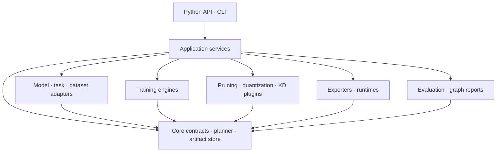
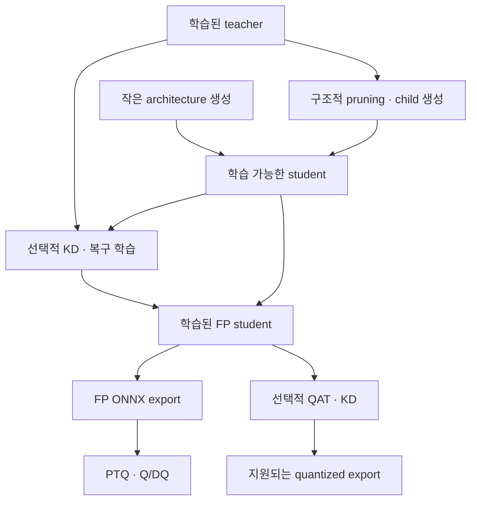

# ModelOctopus 아키텍처

문서 버전: 0.1. 작성일: 2026-10-28. 모든 기능은 목표 설계이며 구현 완료를 뜻하지 않는다.

## 1. 목표와 첫 범위

사용자가 학습 가능한 모델을 생성하거나 기존 가중치를 불러와 학습하고, 작은 student 또는 저정밀 모델을 만든 뒤 동일한 데이터로 평가하고 대상 runtime에서 실행할 수 있는 Python 라이브러리를 만든다. Python API가 중심이며 CLI는 같은 application service를 호출한다. 처음부터 웹 SaaS·원격 GPU 클러스터를 만들지 않는다.

초기 task는 image classification과 object detection이다. segmentation·pose·LLM은 확장 지점만 두고 별도 adapter가 생기기 전에는 미지원으로 표시한다. 생성형 모델의 KV cache/vector quantization은 CNN의 weight/activation INT8 quantization과 입력·수명·export 계약이 달라 이후 독립 plugin 계열로 다룬다.

| 사용자 요구 | 설계상 구현 |
|---|---|
| 여러 모델 불러오기 | ModelProvider + ModelAdapter + 모델 registry |
| 새 모델/기존 가중치로 학습 | 생성, fine-tune, resume를 구분한 TrainRequest |
| 로컬/제공 데이터셋 | DatasetProvider + DatasetManifest + task별 DataModule |
| Quantization | AIMET PTQ baseline, custom quantization plugin, 후속 QAT |
| Pruning | 물리적 구조 변경과 mask pruning을 구분한 PruningStrategy |
| 학생 모델·KD | student 생성/복제와 DistillationObjective를 분리 |
| Torch 배포 | PyTorch artifact + Eager runtime, 선택적 ExportedProgram |
| Tensor 배포 | 여기서는 TensorRT engine + TensorRT runtime으로 해석 |
| ONNX 배포·그래프 | ONNX artifact + ORT runtime + Netron + graph report |

PyNetsPresso의 trainer/compressor/quantizer/converter/profiler라는 사용자 기능 구분을 참고한다. 공식 README에는 계정/API key 사용과 서비스별 기능이 안내되어 있다. 이 프로젝트는 공개 사용자 흐름을 참고해 **로컬 실행과 연구 확장**을 구현하며, 공개 Python wrapper만으로 서비스 내부 알고리즘까지 얻을 수 있다고 가정하지 않는다. 알고리즘 및 제품 UI를 그대로 복제하지 않는다. [S1]

## 2. 핵심 결정

| 결정 | 이유 |
|---|---|
| 학습 가능한 원본 표현은 PyTorch | YOLO, torchvision, custom nn.Module과 연구 코드의 연결이 쉽다 |
| ONNX는 export/최적화/추론 표현 | ONNX import만으로 원래 학습 코드와 optimizer를 복원하지 않는다 |
| 지원 기능을 모델·task·backend별 선언 | “로드 가능”과 “pruning/KD/export 가능”은 다르다 |
| artifact는 불변, 변경마다 새 child | teacher 오염·가중치 덮어쓰기·잘못된 encoding 재사용을 막는다 |
| 연구 방식과 실행 backend를 분리 | 수학적 아이디어가 runtime에서 지원되는지를 별도로 검증한다 |
| 배포를 export/build/package/run으로 분리 | 파일 생성과 실제 추론 성공을 구분할 수 있다 |
| task별 정답·loss·출력 계약 유지 | 분류 softmax KD를 YOLO에 그대로 적용하지 않는다 |
| 순수 core와 optional dependency | ONNX 조회에 Ultralytics/AIMET/TensorRT를 모두 설치할 필요가 없다 |

프레임워크 전체를 자체 구현하지 않는다. PyTorch의 autograd, Ultralytics의 기본 학습, AIMET의 검증용 baseline, Torch-Pruning의 dependency 분석, Netron의 graph viewer를 adapter 뒤에서 재사용한다. 사용자 연구의 차별점은 quantizer·범위 추정·오차 보정·distillation objective와 공정한 평가에 둔다.

## 3. 모듈 관계

| 패키지 | 책임 | 포함하지 않을 책임 |
|---|---|---|
| `core/` | spec, artifact ref, capability, 오류, registry, schema | torch import, YOLO 내부 접근 |
| `application/` | use case, 계획 검증, stage 실행·기록 | 모델별 loss 계산 |
| `models/` | 생성, 로드, 모델 구조 복원, 모델 adapter | 데이터 다운로드 |
| `tasks/` | label, loss, prediction, metric 의미 | 파일 저장·컨테이너 제어 |
| `data/` | provider, split, transform, DataModule | 학생 모델 학습 |
| `training/` | generic/native engine, checkpoint·optimizer·resume | ONNX가 학습 가능하다고 추정 |
| `compression/pruning/` | 계획·구조 변경·복원 명세 | 실제 latency를 FLOPs로 대체 |
| `compression/quantization/` | PTQ/QAT strategy, simulation, encoding | 모든 bitwidth에 native kernel이 있다고 가정 |
| `distillation/` | objective, feature tap, teacher 실행·alignment | 탐지 assigner를 분류 loss로 대체 |
| `export/` | TorchExport/ONNX graph 생성 | 원격 장치에 활성화 |
| `runtime/` | PyTorch, ORT, TensorRT load/run | 재학습 |
| `deployment/` | build, package, runtime profile, release metadata | v1 fleet 업데이트·canary |
| `evaluation/` | task metric, 수치 비교, 대상 측정 | 시각화 성공을 정확도 검증으로 취급 |
| `visualization/` | Netron 연결, graph 구조·diff 보고서 | v1에서 자체 대형 그래프 UI 구현 |
| `tracking/` | 로컬 run 기록, 선택적 MLflow adapter | core API를 MLflow 객체에 종속 |

`plugins/`는 registry 및 탐색 경계를 제공한다. 학습 trainer를 상속해야 하는 특수 통합은 해당 adapter에 둔다. source tree 안에 단일 `if model_name == ...` 거대 분기문을 만들지 않는다.

## 4. 데이터와 모델은 독립적으로 준비한다

모델 생성은 architecture와 initialization을 분리한다. 예: ResNet18 구조 생성 + random 초기화, pretrained weight 로드, local state_dict 로드. 분류 head의 class 수가 다르면 `replace_head` 정책을 명시하고 새 head만 초기화한다. 전체 `strict=False`로 잘못된 구조를 무시하지 않는다. 생성한 artifact에는 실제로 로드·제외·초기화한 key 목록을 남긴다.

`weights: pretrained` 같은 편의 입력은 구체적 weight revision 및 다운로드 해시로 해석한 뒤 manifest에 기록한다. `DEFAULT`가 나중에 다른 weight를 가리키더라도 이전 실행을 재현할 수 있어야 한다. torchvision은 다양한 architecture와 pretrained weight 선택을 제공하므로 첫 분류 provider에 적합하다. [S2]

모델 지원 최소 집합:

| Provider | 초기 모델 | task | 구현 주의점 |
|---|---|---|---|
| torchvision | resnet18, mobilenet_v3_small | classification | head 교체·weight transform·class mapping |
| ultralytics | yolov8n detect, 이후 yolov8s | detection | loss, stride, raw head, export output, 학습 wrapper의 버전 |
| custom | 등록된 nn.Module factory | 선언된 task | architecture spec, example inputs, adapter와 serializer 필수 |
| timm | 후속 선택 | classification | import가 된다고 자동 full support로 표시하지 않음 |

dataset 지원 최소 집합:

| Provider/형식 | 용도 | 분리 정책 |
|---|---|---|
| synthetic classification/detection | offline CI smoke | 정확도 성능 근거로 사용 금지 |
| torchvision CIFAR-10 | 분류 학습·KD 실험 | 공식 train을 train/val로 나누고 공식 test 보존 |
| ImageFolder 또는 manifest | 사용자 분류 데이터 | class-to-index 고정 |
| YOLO detection YAML | 사용자 탐지 데이터 | 이미지/라벨·class mapping 검증 |
| COCO8 | YOLO 연결 smoke | 4장 학습·4장 평가, 별도 final test 없음 |
| COCO detection JSON | 후속 실제 탐지 평가 | category id와 연속 class index 매핑 |

`DatasetManifest`에 데이터 revision, 이미지·annotation hash, split, sample_id, class mapping, task, group_id(camera/session), transform revision, 출처를 기록한다. calibration은 train의 부분집합이어도 되지만 val/test와 겹치면 안 된다. 대규모 데이터는 항목별 해시 목록 파일 + 전체 목록 해시로 관리한다. 경로 변경만으로 dataset identity가 바뀌지 않도록 상대 sample_id와 content hash를 사용한다.

미라벨 calibration 입력은 지원 가능하나 accuracy 평가 데이터와 구분한다. 파일 바이트 중복 검사와 camera/session 단위 split은 별개의 검증이다. 증강 전 원본 sample_id를 기준으로 누출을 검사한다. 개발 평가에 반복 사용한 데이터를 최종 holdout이라고 표시하지 않는다.

학습·calibration·evaluation transform은 별도로 명시하고, calibration/evaluation/runtime 전처리는 같은 계약을 공유한다. teacher와 student가 다른 입력 해상도를 요구하면 동일한 증강 geometry의 두 view와 좌표 변환 metadata를 생성한다. 서로 다른 random crop 결과를 무조건 feature MSE로 비교하지 않는다.

## 5. 학습: generic engine과 native engine

`TrainingEngine`은 두 경로를 갖는다.

- `torch`: 분류·custom nn.Module의 공통 loop. loss hook, KD objective, QAT observer schedule, AMP, checkpoint를 직접 제어한다.
- `ultralytics_native`: 초기 YOLO 학습을 upstream trainer에 위임한다. library는 데이터·모델·config를 해석하고 결과를 공통 artifact로 가져온다.

YOLO에 generic 분류 loop를 억지로 적용하지 않는다. 연구용 YOLO pruning/KD 단계에서는 native trainer가 전달받은 pruned module을 새 원래 구조로 재생성하지 않는지 확인하고, loss 계산 전후의 feature/gradient hook을 정확히 제공하는 `ultralytics_research` adapter를 추가한다. 해당 adapter가 검증되기 전에는 YOLO custom KD/pruning 재학습을 unsupported로 처리한다.

학습 요청의 세 가지 의미:

| 모드 | 시작점 | optimizer/scheduler | 검증 |
|---|---|---|---|
| scratch | 새 architecture/random weights | 새로 생성 | class·input contract 일치 |
| finetune | 모델 가중치 | 새로 생성 | 구조 호환·head 교체 내역 |
| resume | 학습 상태 checkpoint | 복원 | 동일 architecture/data/config 조건, engine 호환 |

resume에는 model/optimizer/scheduler/scaler, epoch·global_step, RNG·sampler 상태가 필요하다. MVP는 **epoch 경계 resume**만 보장하고 mid-epoch 정확 재개는 지원하지 않는다. 학습 데이터나 구조가 바뀌면 resume가 아니라 새 finetune run이다. pruned model에는 원래 optimizer state를 무검증 재사용하지 않는다.

## 6. student 생성과 압축 순서

student는 원본을 수정해 만든 child일 수도 있고, 독립적으로 생성한 작은 architecture일 수도 있다. quantized artifact는 저정밀 모델이지 반드시 별도의 작은 architecture인 것은 아니다. KD는 이미 정한 student를 학습하는 방법이며 그 자체로 parameter 수를 줄이는 연산은 아니다.

S→F는 KD를 쓰지 않는 supervised 학습/복구 경로다. 기본 recipe는 `teacher 학습 → student 생성 또는 pruning → supervised/KD 복구 → FP 평가 → PTQ → 대상 평가`이다. PTQ된 추론 ONNX에 일반적인 역전파를 붙여 KD를 한다고 설계하지 않는다. QAT+KD는 fake-quant가 포함된 학습 가능한 PyTorch student에서 수행한다.

### Pruning

MVP의 실제 경량화는 구조적 channel pruning이다. unstructured mask는 연구 baseline으로 둘 수 있지만 tensor shape가 그대로이면 dense runtime의 파일 크기·latency가 줄었다고 주장하지 않는다. `prune.remove()`로 mask를 적용했다고 채널 수가 줄어드는 것은 아니다. [S3]

처음에는 TinyCNN/ResNet18에서 output classifier 차원을 보존하며 channel pruning을 검증한다. residual add, concat, grouped/depthwise conv 등 의존성을 따라 연관 채널도 함께 바꾼다. dependency graph 생성 시 backend가 autograd를 요구할 수 있으므로 compression 전체를 무조건 `no_grad`로 감싸지 않는다. Torch-Pruning은 이 의존성 분석을 제공한다. [S4]

각 결과에 `PruningPlan`을 남긴다: 원본 architecture/hash, module path, 순차 변경 index, retained channel indices, group 관계, target budget, 실제 shape 변경. 축소 모델을 저장할 때 **원래 architecture spec + 새 state_dict만** 저장하지 않는다. model adapter의 `ArchitectureRecipe`로 축소 구조를 다시 만든 뒤 state_dict를 읽어야 한다. 재구성이 불가능한 임의 모델은 load/export 지원 여부를 제한한다.

새 프로세스에서 구조 복원 → weight load → forward/backward → export까지 통과해야 지원 완료다. Torch-Pruning 예제의 전체 module pickle 저장을 유일한 장기 artifact 형식으로 채택하지 않는다. 필요하면 신뢰된 로컬 연구용 파일로 분리하고 범용 배포 산출물로 취급하지 않는다.

### Quantization

첫 backend는 기존 프로젝트와 같은 `PyTorch → FP32 ONNX → AIMET-ONNX PTQ → standard Q/DQ ONNX`다. 모델별 편의 exporter와 calibration을 감추되 source graph·encodings·Q/DQ를 모두 기록한다. [S5]

연구 인터페이스는 observer, encoding estimator, quantizer/fake-quant, rounding/error-correction, quantization policy, exporter/lowering을 나눈다. 고급 PTQ 중 gradient 기반 최적화를 사용하는 방법도 있으므로 `PTQ => requires_grad=False`를 전역 규칙으로 만들지 않는다. labels가 필요한지, gradient가 필요한지, weight를 수정하는지는 plugin capability로 선언한다.

simulation에서 성공한 사용자 quantizer가 ONNX/TensorRT에서 그대로 실행된다고 가정하지 않는다. uniform affine quantization은 지원되는 dtype·axis·scale 조건에서 표준 Q/DQ로 표현할 수 있다. nonuniform/vector/codebook quantization은 별도 graph decomposition 또는 custom operator/runtime kernel이 필요할 수 있다. 표현할 수 없으면 `research_only`로 표시하고 export를 명시적으로 실패시킨다.

초기 TensorRT INT8 profile은 signed symmetric activation per-tensor, Conv weights per-channel, constant positive scale, zero_point=0을 목표로 검사한다. backend version과 operator가 지원하는 범위만 허용한다. 모든 runtime에 이 정책을 전역 적용하지 않는다. graph/weights/preprocessing이 바뀌면 calibration 결과를 다시 계산한다.

### Knowledge Distillation

첫 구현은 분류 logit KD 및 선택적인 feature KD다. logits, features, class mapping, feature tap의 의미를 `TaskAdapter`가 제공한다. KL 기반 분류 KD는 teacher를 eval/frozen 상태로 실행하고 student만 업데이트하며 temperature에 따른 손실 스케일링을 명시한다. [S6]

탐지는 box regression, class scores, multi-scale features, foreground/assignment 의미가 추가된다. YOLO의 independent class score에 분류 softmax KL을 자동 적용하지 않는다. 첫 detection KD는 같은 YOLO 계열·같은 class set·같은 입력 geometry로 제한하고, class loss/box loss/feature alignment를 detector adapter가 정의한다. 서로 다른 계열 간 KD는 후속 연구 범위다.

KD용 projection/alignment module은 학습 optimizer와 checkpoint에 포함한다. 학습 전용 module은 export 시 제외하되 student 추론 기능에 필요한 adapter는 보존한다. teacher cache는 sample hash뿐 아니라 teacher revision, transform/augmentation seed, feature spec에도 종속된다. 초기에는 online teacher forward로 단순화한다.

## 7. 배포는 네 단계다

| 단계 | 결과 | 완료 의미 |
|---|---|---|
| export | ONNX 또는 ExportedProgram | 변환 성공 및 graph/checker 검사 |
| build | 대상 TensorRT engine 등 | 대상 profile에서 compilation 성공 |
| package | versioned bundle | model + 전후처리 + labels + runtime 요구사항 묶음 |
| run/validate | prediction·측정 보고서 | 실제 runtime에서 추론·품질 확인 |

| 사용자 선택 | artifact | 실행 backend | 제약 |
|---|---|---|---|
| `torch` | reconstructable model bundle | PyTorch eager | model provider 및 구조 recipe가 설치되어 있어야 함 |
| `torch_export` | `.pt2` ExportedProgram | 호환 PyTorch 또는 별도 lowering | 독립 native runtime 자체가 아님 |
| `onnx` | `.onnx` + 필요 시 external data | ONNX Runtime | opset/EP/연산/정밀도별 지원 확인 |
| `tensorrt` | `.engine` + build manifest | TensorRT | GPU·OS·CUDA·TensorRT·build flags 호환 profile 필요 |
| `executorch` | `.pte` | ExecuTorch | 후속 plugin, ONNX→pte 보편 경로를 가정하지 않음 |

TorchScript는 공식적으로 deprecated이므로 새 기본 경로는 Eager bundle/torch.export로 잡고, 필요할 때만 legacy exporter를 분리한다. `torch.export`가 자체적으로 모든 배포 환경의 실행기를 제공하는 것은 아니다. [S7]

TensorRT engine은 기본적으로 대상 환경에 맞춰 빌드한다. 특정 compatibility flag가 지원하는 예외는 별도 profile로 검증한다. “같은 NVIDIA GPU 계열”만으로 엔진 호환성을 보장하지 않는다. ORT TensorRT EP와 직접 TensorRT runtime은 서로 다른 backend로 관리하고 초기 TensorRT 구현은 직접 backend 하나로 제한한다. [S8][S9]

`runtime.predict()`의 외부 출력은 classification probability/label 또는 detection bbox/score/class로 정규화한다. 내부 수치 비교는 class logits·NMS 이전 decoded output 등 정확히 지정한 tensor를 사용한다. 연산 그래프에 NMS가 포함됐는지 manifest에 기록하여 이중 NMS를 막는다.

ONNX/TensorRT import artifact에는 기본적으로 inference capability만 부여한다. 일반적인 학습 요청이 들어오면 원본 trainable artifact를 요구한다. `.pt` 확장자만으로 state_dict/full module/TorchScript를 자동 구분하지 않는다.

## 8. ONNX 그래프 기능

1. `graphs.inspect(artifact)`는 checker 결과, graph inputs/outputs, opset, op histogram, tensor dtype/shape, parameter bytes, Q/DQ 위치를 JSON/HTML로 반환한다.
2. `graphs.view(artifact)`는 로컬 Netron viewer handle과 URL을 반환한다. 자동 브라우저 실행은 선택 사항이다. Netron은 ONNX를 지원하며 Python에서 사용할 수 있다. [S10]
3. `graphs.diff(before, after)`는 node/op/shape 변화와 Q/DQ 삽입 위치를 요약한다. 이름이 같다고 같은 연산이라고 단정하지 않고 exporter provenance/node mapping이 없으면 unmatched로 표시한다.
4. viewer에서 파일이 열린다는 사실은 runtime 실행 또는 정확도 증명이 아니다. 미해석 shape는 unknown으로 보여준다.

기본 bind는 localhost이다. Docker viewer는 컨테이너 내부 bind와 host의 localhost port publishing을 분리한다. 외부 웹서비스나 모델 업로드 서버 없이 로컬 파일을 보여주는 구성이 첫 범위다. 최적화 전후 전체 그래프를 그리는 자체 UI는 만들지 않고, 부가 분석 report부터 추가한다.

## 9. Artifact·실행 이력·환경

`ArtifactRef`는 id/kind/digest를 가지며 artifact content는 manifest + files로 구성한다. `kind`는 trainable_torch, onnx_fp, onnx_qdq, torch_export, tensorrt_engine, training_state, dataset, evaluation 등으로 구분한다. precision은 모델 전체 단일 숫자가 아니라 tensor/layer별 policy 및 실제 exported graph와 연결한다.

반드시 기록할 항목:

- 원본/parent/teacher/student artifact, model provider/adapter/serializer revision.
- architecture recipe, checkpoint hash, dataset/split/labels/transform revision.
- train/quant/prune/KD config, algorithm version, code commit 또는 source digest.
- calibration sample 목록·순서·hash, exporter opset·shape constraints, quantizer exclusions.
- environment lock, container digest, 실제 GPU/runtime profile, 측정 조건과 결과.
- 파일별 SHA-256, ONNX external tensor file을 포함한 bundle 전체 목록.

operation은 staging directory에 쓰고 모든 검증이 끝나면 artifact를 원자적으로 publish한다. 실패 파일은 diagnostic 경로에 남기되 정상 artifact registry에는 등록하지 않는다. job 상태는 planned/running/succeeded/failed/cancelled이고 검증 결과는 passed/failed/not_run/skipped를 구분한다.

cache key는 입력 digest + resolved config + plugin/code/env revision + relevant hardware profile이다. seed가 같아도 모든 하드웨어에서 bitwise 동일 학습을 보장하지 않는다. 캐시는 기존 결과를 명시적으로 재사용하는 것으로 기록한다.

초기 실행기는 단일 process 또는 로컬 subprocess이다. core 자체는 backend를 import하지 않고 worker가 필요한 extra만 로드한다. profile은 `core-ci`, `train-cpu`, `train-cuda`, `quant-aimet`, `deploy-tensorrt`로 나눠 잠근다. 이전 YOLO 패키지의 버전 조합은 참고 후보이며 이 새 library 전체의 검증된 lock으로 간주하지 않는다.

## 10. 평가와 연구 실험

| 검증 | 비교 | 의미 |
|---|---|---|
| 생성·복원 | 생성 모델 vs 새 process reload | 구조와 weight 보존 |
| 학습 | 작은 real/synthetic 문제의 loss·gradient | 학습 연결 확인; 서비스 정확도 증명은 아님 |
| export | FP PyTorch vs FP ONNX | 변환 오류 탐지 |
| quantization | FP vs quantized | 양자화 손실 평가 |
| Q/DQ 변환 | simulation vs exported Q/DQ | serialization/lowering 오류 탐지 |
| pruning | original vs pruned/복구 후 | 크기·품질·구조 효과 |
| KD | 동일 student의 supervised-only vs KD | teacher 효과 분리 |
| deployment | 최종 실제 backend | latency·memory·품질 검증 |

분류는 top1/top5(클래스 수에 맞춰), 탐지는 evaluator/protocol을 고정한 mAP50-95·class별 AP를 쓴다. 공정한 비교를 위해 architecture·seed·학습 budget·dataset split·calibration budget·pre/postprocessing을 기록한다. latency는 warmup과 CUDA synchronization, batch·shape·precision·provider·전력 조건을 포함한다. compile/load 시간과 steady-state inference를 구분한다.

pruning ratio, parameter 수, FLOPs/MACs, sparse density, model bytes, peak allocated/reserved memory, host RSS, 실측 p50/p95를 서로 다른 지표로 유지한다. GPU가 없으면 GPU 결과는 not_run이다. CPU mock으로 GPU correctness를 검증했다고 표시하지 않는다.

## 11. 초기 지원 목표와 단계

다음 표의 기호는 **계획**이다. 구현·실제 검증 전 runtime registry의 status는 planned이며 supported가 아니다.

| 조합 | 생성/학습 | FP ONNX | PTQ | Pruning | KD | TensorRT |
|---|---|---|---|---|---|---|
| ResNet18 / MobileNetV3 분류 | M1 | M1 | M3 | ResNet18 M4 | M5 | M7 |
| YOLOv8n 탐지 | M2 | M2 | M3 | M8 | M8 | M7 |
| Custom TinyCNN | M0/M1 | M1 | M3 | M4 | M5 | M7 선택 |
| 임의 nn.Module | 등록·계약별 | 별도 검증 | 별도 검증 | 자동 보장 없음 | adapter별 | 별도 검증 |
| imported ONNX | inference only | 검사 | profile별 PTQ | v1 미지원 | v1 미지원 | M7 |
| custom 비표준 quantizer | 연구용 M6 | lowering 없으면 불가 | 연구용 | 별도 조합 검증 | M6 선택 | kernel 없으면 불가 |

지원 여부는 `model/task/operation/engine/plugin/exporter/runtime/version/profile`의 조합이다. `planned`, `experimental`, `supported`, `unsupported`, `unverified_environment`를 구분하고 unsupported 이유와 다음 지원 경로를 반환한다. 지원되지 않는 조합을 FP32 또는 다른 알고리즘으로 조용히 대체하지 않는다.

## 12. 저장소 목표 구조

ASCII tree 대신 디렉터리별 역할을 표로 고정한다. `src/modeloctopus/` 아래에 core, application, models, tasks, data, training, compression, distillation, export, runtime, deployment, evaluation, visualization, tracking을 둔다. `tests/unit`, `tests/contracts`, `tests/integration`, `tests/hardware`, `examples`, `configs`, `docker`, `docs`, `benchmarks`, `plugins`는 repository root에 둔다.

`pyproject.toml`에는 최소 core dependency와 `torch`, `vision`, `yolo`, `aimet`, `pruning`, `onnx`, `trt`, `viz`, `dev` extra를 선언한다. 실제 충돌하는 extra는 별도 worker env로 안내하고 “all extra” 하나로 모든 플랫폼 설치를 보장하지 않는다.

## 13. 기존 프로젝트에서 가져올 부분

이전 YOLO Edge Lab의 다운로드/학습/export/AIMET/평가 단계를 그대로 한 class에 확장하지 않고 아래로 이동한다.

| 기존 역할 | 새 위치 |
|---|---|
| prepare와 데이터 해시 검사 | data/provider + DatasetManifest validator |
| Ultralytics train | training engine + YOLO adapter |
| export 및 입력 계약 | ModelAdapter.export_view + OnnxExporter |
| AIMET 보정/encoding/QDQ 검사 | AIMET backend plugin + QDQ validator |
| 공통 전처리 | task/adapter의 버전 있는 TransformSpec |
| 단계 상태·파일 해시 | application runner + artifact store |
| 모델 비교 | evaluation service |

이전 작업에서 실제 확인한 것은 다운로드·데이터 준비·일부 계약 테스트였으며 학습·양자화 전체 완료가 아니었다. 따라서 migration 완료와 새 환경에서 E2E 통과는 별도 체크다. 기존 산출물을 검증된 성능 baseline으로 취급하지 않는다.

## 14. 다음 확장

학습/최적화 라이브러리가 안정된 뒤 FastAPI job service, 원격 artifact store, MLflow, field feedback, 재학습 policy, fleet canary/rollback을 추가한다. service는 library API를 호출하며 core를 HTTP나 DB에 종속시키지 않는다. 원격 rollout은 이 설계의 local deployment bundle 생성과 별개다.

향후 CPU/NPU backend, ExecuTorch, IR pass·static memory planning·layout profiler도 추가할 수 있지만, 첫 library가 모든 compiler를 직접 구현하는 구조로 시작하지 않는다. 사용자의 quantization·KD 연구를 실제 export/runtime과 연결하는 것이 우선이다.
